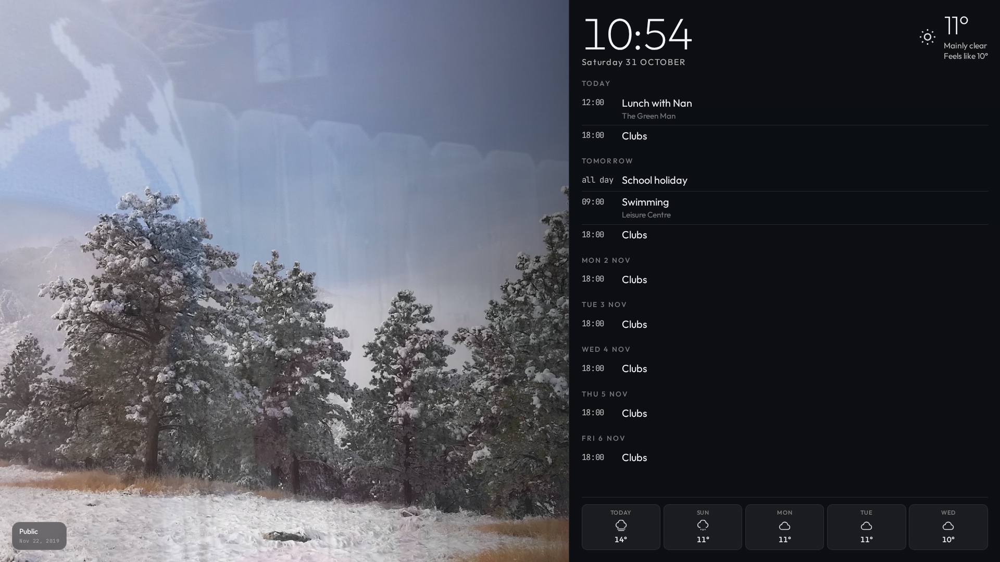

# Family board

A self-hosted family wall board — Google Calendar, a Google Photos album on
rotation, and today's weather, in a fullscreen web page.

Runs on your LAN, survives a reboot, and costs nothing to run. One Python
process, no database, no build step, **no pip dependencies**.



---

## What it does

- **Google Calendar** — as many days as you set (3 by default), with the
  event that is happening *right now* highlighted. OAuth (every calendar on an
  account, with colours) or a plain iCal link.
- **Google Photos** — a shared album on rotation, with slide, fade or
  Ken Burns transitions. The server owns the rotation, so every screen in the
  house shows the same photo at the same moment.
- **Weather** — current conditions and the week ahead, from Open-Meteo. No
  API key.
- **A settings page** — everything above, with a "save and test" button on
  each source so you know it works before you walk away.

The board polls the calendar every **5 minutes**, the weather every **15
minutes** and the album every **30 minutes**, so changes appear on their own
without a reload.

It works on **any screen**. The layout is fluid rather than breakpoint-driven:
the clock and the agenda are sized against the panel they live in (CSS
container queries), so the same page is right on a 360 px phone and a 4K TV.
When space runs out, whole elements are dropped — the type is never shrunk
to fit.

---

## Quick start

```bash
git clone https://github.com/longieirl/dakboard.git
cd dakboard
DAKBOARD_DATA=./data docker compose up -d
```

Open <http://localhost:8099/> and then <http://localhost:8099/settings>.

**Prefer to try it without Docker?** There is nothing to install — the board is
pure standard library:

```bash
DAKBOARD_DATA=~/dakboard-data python3 -B -u -m dakboard
```

**Moving it onto your own hardware?** **[LOCAL-SETUP.md](LOCAL-SETUP.md)** is
the end-to-end guide: what you need, running it bare or in Docker, the Google
OAuth client, the album link, getting onto the LAN, kiosk mode, backups and
troubleshooting. The short version is below.

---

## Setting up Google Calendar

### Option A — iCal (quickest, no setup)

In Google Calendar: **Settings → Integrate calendar → Secret address in iCal
format**. Paste that URL into the settings page.

One calendar, no colours. Google invalidates the URL if the account password
changes.

### Option B — OAuth (recommended)

You have to create a Google Cloud project yourself — there is no shortcut.
Full step-by-step in **[LOCAL-SETUP.md](LOCAL-SETUP.md#google-calendar--oauth)**.

The short version:

1. [Google Cloud Console](https://console.cloud.google.com/) → new project.
2. **APIs & Services → Library** → enable **Google Calendar API**.
3. **Google Auth platform → Clients** → **Create client**.
4. **⚠️ Publish the app.** In **Google Auth platform → Audience**, set the
   publishing status to **In production**. If it stays in **Testing**, Google
   issues refresh tokens that **expire after 7 days** and the board will
   silently stop updating about once a week. You do **not** need to complete
   Google's verification process for a self-hosted, single-user app — users
   just see an "unverified app" notice once, which you click past.
5. Paste the **client ID** and **client secret** into the settings page,
   along with a **redirect URI**.

**The client type decides which redirect URI you can use**, and this is the
part that trips people up:

| Application type | Redirect URIs it accepts | Use it when |
|---|---|---|
| **Desktop app** | `http://localhost:<any port>` and `http://127.0.0.1:<any port>` only | You will do the sign-in **on the same machine as the board** |
| **Web application** | Exact URIs you register. Must be **HTTPS**; **raw IP addresses are not allowed** | The board has a real hostname over HTTPS, e.g. `https://board.longie.net` |

So:

- The board on a Pi/NAS at `http://192.168.1.6:8099`? **Neither** type can
  register that URI — Google rejects a raw IP address with
  `Error 400: invalid_request`, and there is nothing useful on that page.
  Use a **Desktop app** client with the redirect URI
  `http://localhost:8099/oauth/callback`, then use the **"Paste the address
  you were sent to"** box on the settings page to hand the code back to the
  board. It is a one-time step — once the refresh token is stored, the board
  refreshes silently forever and never needs the browser again.
- The board behind Caddy on a real domain? Use a **Web application** client
  and register `https://board.longie.net/oauth/callback`. Cleanest option.
- The board running on the same laptop as your browser? **Desktop app**,
  `http://localhost:8099/oauth/callback`, no paste needed.

The board checks the redirect URI against these rules **before** it sends
you to Google, and tells you which rule you broke — so you get a sentence
instead of an error page.

If the board cannot be reached from the browser that does the sign-in, copy
the address bar URL afterwards and paste it into the settings page — the
board extracts the code from it.

The scope requested is `calendar.readonly`. The board never writes to your
calendar.

**"Error 401: invalid_client"** means Google does not recognise the client
ID or the secret. Usually one of:

- the **client secret** was pasted into the **client ID** field — the client
  ID ends in `.apps.googleusercontent.com` and starts with a number;
- the copy-paste left a **trailing newline** (the board trims these now);
- the client was **deleted** from the Cloud project;
- the two values are from **different projects**.

The board checks the shape of the client ID before it sends you to Google and
tells you if it does not look like one.

---

## Setting up Google Photos

1. In Google Photos, open the album and turn on **Share → Create link**
   (link sharing must be on — a private album will not load).
2. Copy the `photos.app.goo.gl/…` link into the settings page.

> **How this works, and why it is a bit different.**
>
> Google removed the Photos Library API's read access to shared albums on
> **31 March 2025** — the scopes `photoslibrary.readonly` and
> `photoslibrary.sharing` and every `sharedAlbums.*` method now return
> `403 PERMISSION_DENIED`. DAKBOARD itself had to abandon its Google Photos
> integration because of it.
>
> So the board reads the album's **public share page** the way a browser
> does, and pages through it using Google's own `batchexecute` endpoint.
> That is unofficial and Google could change it, so the board **caches the
> last good album list on disk** — if a refresh fails it keeps rotating the
> photos it has rather than going blank. The calendar and weather do not
> depend on this at all.
>
> If Google ever breaks it, point the board at a shared Google Drive folder
> instead; the photo source sits behind an interface, so it is a swap rather
> than a rewrite.

Videos are skipped. The board shows photos only.

---

## Weather

Open-Meteo, which needs no API key. Type a **town name** — the gazetteer
knows towns, not villages or hamlets, so "Welwyn Garden City" works and
"Gosden" does not.

Attribution is required by Open-Meteo's terms; the board links back from the
settings page.

---

## Deploying with Portainer

This repo contains a ready-made stack at `stacks/dakboard/`. Add it to
[`longieirl/portainer-stacks`](https://github.com/longieirl/portainer-stacks)
as `stacks/dakboard/`, then in Portainer:

| Field | Value |
|---|---|
| Repository URL | `https://github.com/longieirl/portainer-stacks.git` |
| Branch | `main` |
| Compose path | `stacks/dakboard/docker-compose.yml` |
| Authentication | Username + fine-grained PAT (Contents: Read-only) |
| GitOps updates | **Polling**, every `24h` |
| Re-pull image | OFF (Watchtower handles image updates) |

`DOCKER_DATA_HOME` and `DOCKER_SHARED_HOME` must be set in Portainer's
Environment Variables tab at stack creation time — Portainer CE has no
global env injection.

For a hostname, add a site block to the `caddy` stack:

```
board.longie.net {
    reverse_proxy dakboard:8099
}
```

The board container joins `proxy_net`, so Caddy reaches it by service name.

### Secrets

There are no secrets in the environment and none in git. The OAuth refresh
token and the iCal URL are entered in the settings page and stored in
`${DOCKER_DATA_HOME}/dakboard/data/config.json` with `0600` permissions.
The settings API masks them, so they never travel back to the browser.

---

## Kiosk mode

The board is designed to run fullscreen and unattended.

```bash
chromium --kiosk --noerrdialogs --disable-infobars --disable-pinch \
         --overscroll-history-navigation=0 http://192.168.1.6:8099/
```

- **Wake Lock** keeps the screen awake; it re-acquires when the tab becomes
  visible again.
- No scrollbars, no rubber-band — the board fills the viewport exactly.
- The mouse pointer hides itself after a few seconds of stillness.
- If the server drops, the board reconnects on its own and falls back to
  polling, so it never shows an error page.

On a Raspberry Pi, set `display=hdmi` in `/boot/config.txt` and autostart the
command above.

---

## Configuration

Everything is configured in the settings page. The board stores it in
`/data/config.json` (0600) and applies changes to every display immediately.

| Setting | Default | Notes |
|---|---|---|
| `calendar.mode` | `ical` | `ical` or `oauth` |
| `calendar.ical_url` | — | secret |
| `calendar.client_id` / `client_secret` / `redirect_uri` | — | secret is masked |
| `calendar.calendar_ids` | `primary` | comma separated |
| `calendar.days_ahead` | `3` | how many days to show, and how far ahead to fetch |
| `photos.album_url` | — | the shared album link |
| `photos.transition` | `slide` | `fade`, `slide` or `kenburns` |
| `photos.transition_ms` | `1000` | |
| `photos.rotate_seconds` | `6` | |
| `photos.shuffle` | `true` | |
| `photos.refresh_minutes` | `30` | how often to re-read the album |
| `weather.place` | `Welwyn Garden City` | |
| `weather.units` | `celsius` | |
| `weather.show_week` | `true` | |
| `display.layout` | `A` | `A` split, `B` overlay, `C` cinematic |
| `display.theme` | `dark` | |
| `display.clock_24h` | `true` | |
| `display.hide_cursor` | `true` | |

---

## How it is built

```
dakboard/
  config.py     dotted-path config store, EDITABLE allowlist, secret masking
  calendar.py   OAuth refresh + Calendar API, and the iCal fallback
  ical.py       a small RFC 5545 parser (recurrence, TZID, all-day, folding)
  photos.py     the shared-album scraper
  weather.py    Open-Meteo client
  state.py      the shared state the server owns
  server.py     HTTP, the SSE stream, the settings API
static/
  index.html    the board
  settings.html the settings page
tests/          93 tests, standard library only
```

**The server owns the state.** The photo rotation index, the cached calendar,
weather and album list, and the clock all live on the server, and the board
pushes updates over Server-Sent Events. The browser holds no secrets, fetches
nothing from Google, and keeps no state worth losing. That is what lets
several screens stay in sync.

**The DOM is built once.** Updates write only the cells that changed, so a
continuous feed causes no layout thrash.

### Tests

```bash
python3 -B -m unittest discover -s tests -v
```

The suite includes a check that the settings page and the config store cannot
drift apart — in both directions — because that exact bug once made a
settings page save almost nothing while looking like it worked.

It also checks that **no CSS variable is used without being defined**. An
undefined `var(--pad)` does not fall back to anything: the declaration is
dropped, `padding` becomes 0, and the board quietly loses its gutter. That
happened, and every layout check still passed — overflow tests cannot see a
missing gutter.

### The layout check

The layout is fluid rather than breakpoint-driven, so "does it fit?" is not a
question CSS can answer on its own. `tests/layout_check.py` runs the board in
a real browser at **13 screen sizes × 3 layouts**, with a real (synthetic)
calendar loaded, and fails if anything scrolls, overflows the viewport, clips
text or drops below the type floors.

```bash
python3 -B tests/layout_check.py --shots /tmp/shots
```

It needs Playwright and Chromium. This is what catches the awkward cases — a
480×360 window, an ultrawide, a 4K TV — that no amount of staring at one
screen size would reveal.

---

## Licence

MIT.
